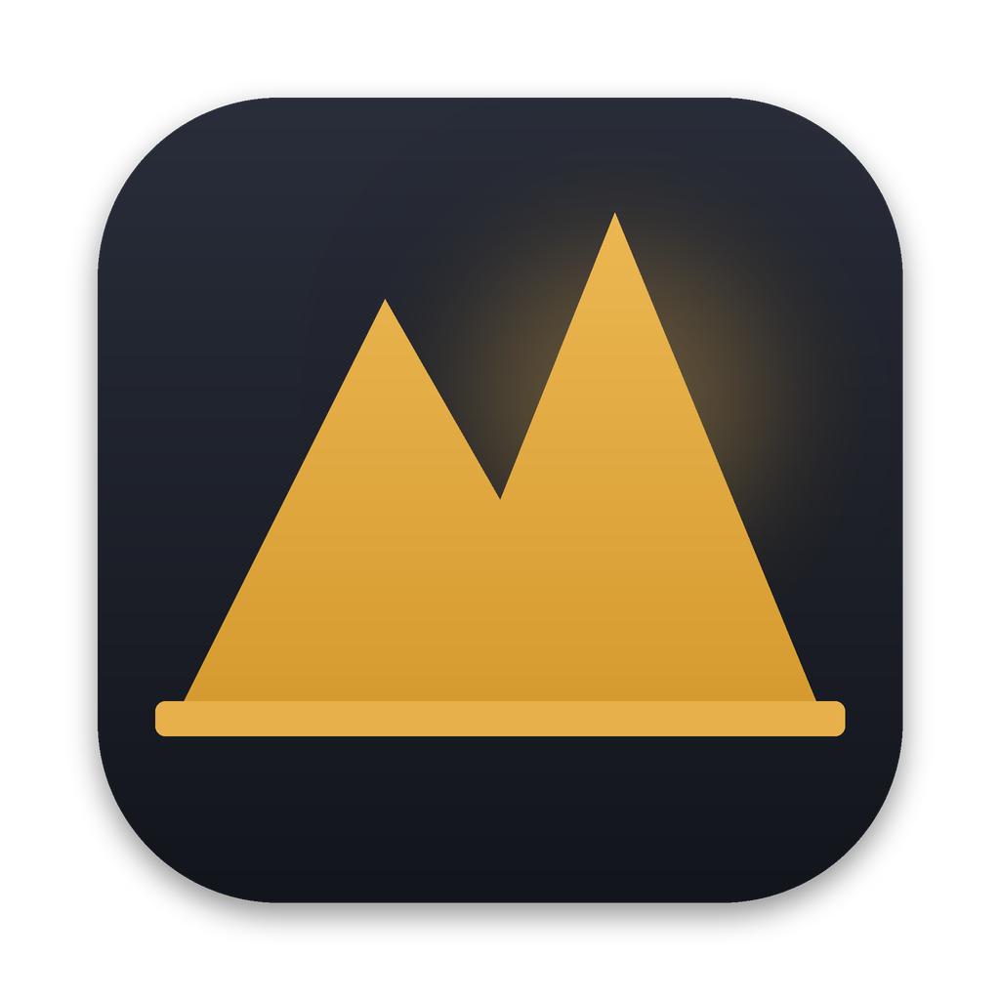
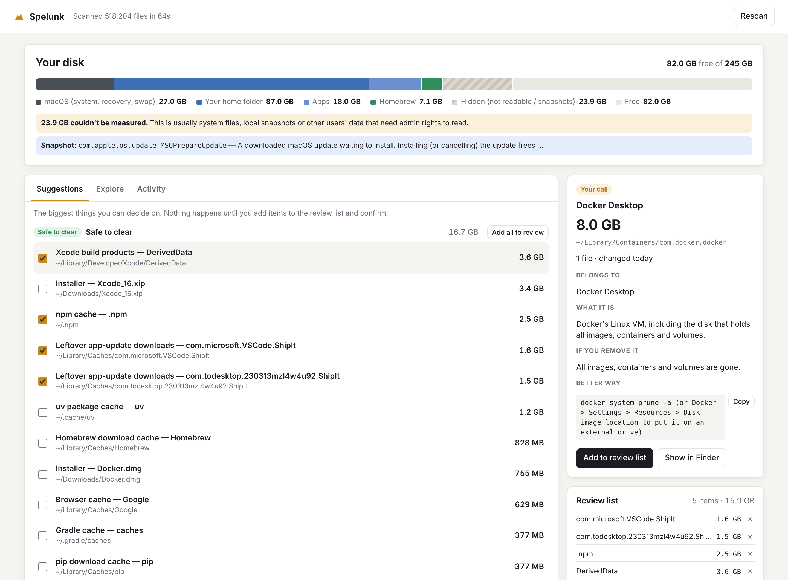
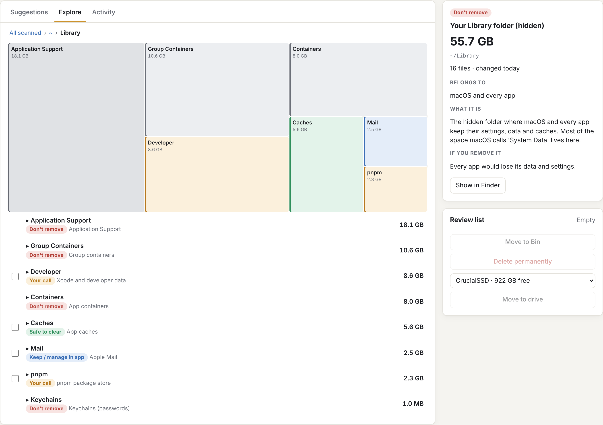
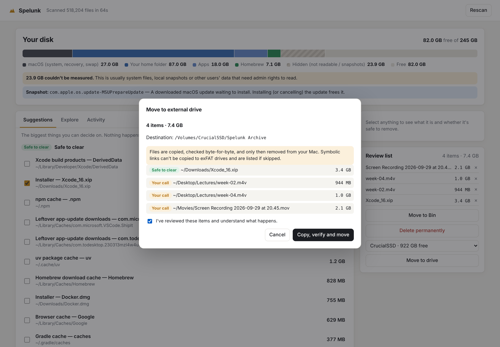
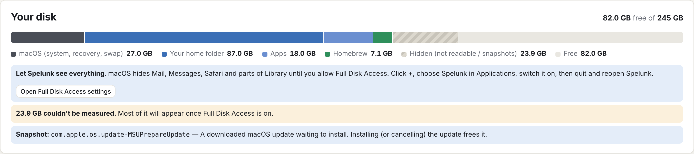

<p align="center">
  
</p>

<h1 align="center">Spelunk — a free MacBook storage cleaner</h1>

<p align="center">
  <b>See what's really filling your Mac — including the hidden "System Data" — and decide, item by item, what to delete or move to an external drive.</b>
</p>

<p align="center">
  <a href="https://github.com/mazzyy/spelunk/releases/latest/download/Spelunk-macOS-arm64.dmg"><b>⬇&nbsp;&nbsp;Download Spelunk for Mac</b></a>
  &nbsp;·&nbsp; Apple silicon · macOS 12+ · free &amp; open source
  <br><br>
  <a href="https://github.com/mazzyy/spelunk/releases/latest"></a>
  <a href="https://github.com/mazzyy/spelunk/actions/workflows/ci.yml"></a>
  
  <a href="LICENSE"></a>
</p>

<picture>
  <source media="(prefers-color-scheme: dark)" srcset="docs/dark.png">
  
</picture>

---

## Why is my Mac storage full?

On a 256 GB MacBook it's common for **"System Data" to grow to 50–100 GB** with no explanation. macOS's Storage settings won't tell you what's inside, Finder hides it, and deleting the wrong folder in `~/Library` breaks apps.

It's usually a mix of things like these:

| What | Typical size | What Spelunk tells you |
|---|---|---|
| Docker's virtual disk | 5–60 GB | Your call — prune it with `docker system prune -a` |
| WhatsApp / Messages photos and videos | 2–30 GB | Keep — clean it inside the app (it shows you where) |
| Xcode build files, simulators, device support | 5–50 GB | Build files are safe to clear; simulators are your call |
| Leftover app-update downloads (VS Code, Cursor, Slack…) | 1–5 GB | Safe to clear |
| npm / pnpm / pip / uv / Homebrew caches | 2–20 GB | Safe to clear, or the right cleanup command |
| `node_modules` and Python virtual environments in old projects | 1–10 GB | Your call — they reinstall in one command |
| AI models (Ollama, LM Studio, Hugging Face) | 5–100 GB | Your call — or move them to an external drive |
| A downloaded macOS update that was never installed | 5–20 GB | Install or cancel the update to free it |
| Old videos and screen recordings | anything | Move them to your external SSD |

Spelunk finds these, explains each one in plain language, rates how safe it is to remove, and **only acts when you confirm**.

## Features

### Suggestions: the biggest things you can decide on
Grouped into **Safe to clear**, **Your call** and **Manage inside the app**. Every item says what it is, which app it belongs to, what happens if you remove it, and the better way to shrink it, with a copy button for commands such as `docker system prune -a`. *(Screenshot above.)*

### Explore: a map of any folder
Click through your disk as a treemap. Colours show what's safe (green), your call (amber), app data to keep (blue) and folders you shouldn't remove (grey).



### Review, then confirm
Nothing happens until you add items to the **review list** and confirm a plan that shows every item, its size and what will happen. Choose **Move to Bin** (recoverable), **Delete permanently**, or **Move to drive**.



### Move files to your external SSD, safely
Files are copied, **checked byte-for-byte (SHA-256)**, and only then removed from your Mac. A `manifest.jsonl` on the drive records where everything came from. If anything fails, the original stays where it was.

### Sees what other tools can't
It shows macOS's own volumes (System, Preboot, Recovery, swap), local snapshots such as an update waiting to install, and how much space it still can't read and why. If macOS is hiding protected folders, Spelunk tells you how to allow Full Disk Access with one button.



Light and dark mode follow your Mac's setting.

---

## Install the app

1. **[Download Spelunk for Mac](https://github.com/mazzyy/spelunk/releases/latest/download/Spelunk-macOS-arm64.dmg)** (or pick a version from [Releases](https://github.com/mazzyy/spelunk/releases)).
2. Open the downloaded `Spelunk-macOS-arm64.dmg` and drag **Spelunk** onto the **Applications** folder.
3. Open **Spelunk** from Applications or Launchpad.
4. **The first time only**, macOS may say Spelunk "can't be opened" because it isn't from the App Store or an identified developer yet:
   - Open **System Settings › Privacy & Security**.
   - Scroll down to *"Spelunk was blocked to protect your Mac"* and click **Open Anyway**, then confirm.
   - *(Terminal alternative: `xattr -dr com.apple.quarantine /Applications/Spelunk.app`)*
5. To let Spelunk see protected folders (Mail, Messages, parts of Library), click **Open Full Disk Access settings** in the app, click **+**, choose **Spelunk**, switch it on, then quit and reopen Spelunk.

The downloadable app is for **Apple silicon Macs (M1 and newer)**. On an Intel Mac, [install from source](#install-from-source) or [build the app yourself](#build-the-app-yourself).

**Uninstall:** drag Spelunk from Applications to the Bin and delete the `~/.spelunk` folder (the action log).

---

## Install from source

Use this if you're on an Intel Mac, want the latest code, or want to contribute.

**1. Open Terminal**: press <kbd>⌘</kbd> <kbd>Space</kbd>, type *Terminal*, press <kbd>Return</kbd>.

**2. Make sure you have Python 3 and git.** Check with:

```bash
python3 --version
git --version
```

If either is missing, install Apple's free Command Line Tools (a few minutes, about 1 GB):

```bash
xcode-select --install
```

**3. Download Spelunk**

```bash
git clone https://github.com/mazzyy/spelunk.git
cd spelunk
```

No git? Click **Code › Download ZIP** on this page, unzip it, then `cd ~/Downloads/spelunk-main`.

**4. Run it**

```bash
python3 -m spelunk
```

Your browser opens the dashboard and the first scan starts (about a minute on a typical developer Mac). Spelunk has **no dependencies**, so nothing else needs installing.

Want it in its own window instead of a browser tab?

```bash
python3 -m venv .venv
source .venv/bin/activate
pip install pywebview==6.1
python -m spelunk app
```

**5. Allow Full Disk Access (optional, recommended).** In System Settings › Privacy & Security › Full Disk Access, add the app you run Spelunk from (Terminal, iTerm, VS Code…), restart it and run Spelunk again.

**Update:** `git pull` inside the `spelunk` folder. **Uninstall:** delete the folder and `~/.spelunk`.

### Terminal commands

```bash
python3 -m spelunk                 # dashboard in your browser (default)
python3 -m spelunk app             # dashboard in its own window (needs pywebview)
python3 -m spelunk scan            # text report of the largest items, with explanations
python3 -m spelunk scan ~ --top 50 # only your home folder, top 50
python3 -m spelunk explain ~/Library/Caches/com.microsoft.VSCode.ShipIt
```

---

## Build the app yourself

On a Mac (Apple silicon builds an Apple silicon app; Intel builds an Intel app):

```bash
packaging/build_app.sh
open dist/Spelunk.app
```

This creates `dist/Spelunk.app` and a drag-to-install `dist/Spelunk-macOS-<arch>.dmg`. The build installs PyInstaller and pywebview into a throwaway `.build-venv`; Spelunk itself stays dependency-free.

## How safety works

| Rule | Why |
|---|---|
| Nothing happens without a plan you've seen | Every action shows the exact items, sizes and warnings first. |
| Plans are single-use and expire after 10 minutes | A stale plan can't be replayed. |
| "Don't remove" items and system folders are blocked in code | Keychains, `/System`, your home's top-level folders, `~/.ssh` and more are refused, even if a rule file is edited badly. |
| "Your call" / "Keep" items need an extra confirmation | You tick "I've reviewed these items". |
| Moves are copy → verify → delete | SHA-256 for every file, plus a manifest on the drive. |
| Move to Bin is the default | You can restore from the Bin. Space is freed when you empty it. |
| Everything is logged | `~/.spelunk/actions.jsonl` and the **Activity** tab. |

## Privacy

Spelunk runs entirely on your Mac. No account, no telemetry, no uploads, no network calls. The dashboard is served only on `127.0.0.1` with a random token for each launch, so other websites and apps can't talk to it.

## FAQ

**Does Spelunk delete anything automatically?**
No. It only suggests. You choose items, review the plan and confirm.

**Why does it want Full Disk Access?**
macOS hides Mail, Messages, Safari and parts of `~/Library` from every app by default, and those are often where "System Data" lives. Without access Spelunk still works and shows that space as *hidden*.

**What's the difference between Move to Bin and Delete permanently?**
Bin is recoverable but only frees space after you empty the Bin. Delete frees space immediately and can't be undone.

**Can I get files back after moving them to my SSD?**
Yes. They're in `Spelunk Archive/` on the drive, in the same folder structure as on your Mac, and `manifest.jsonl` lists the original location of each item.

**Is it safe to clear caches?**
Items marked *Safe to clear* are rebuilt automatically by their app. Quit the app first. Spelunk never marks anything as safe if removing it could lose your data.

**Intel Mac?**
Install from source or build the app yourself on that Mac. Both work.

---

## Releasing (maintainers)

Pushing a version tag builds the DMG on GitHub's Mac runners and attaches it to a GitHub Release as `Spelunk-macOS-arm64.dmg`, so the download link above always points to the newest version:

```bash
# bump __version__ in spelunk/__init__.py and pyproject.toml first
git tag v0.1.1
git push origin v0.1.1
```

To remove the "Open Anyway" step for users, add an Apple Developer ID certificate and notarization credentials as repository secrets; the workflow signs and notarizes automatically when they're present. See the comments at the top of `.github/workflows/release.yml`.

## Project layout

```
spelunk/
  scanner.py        fast stdlib scanner (allocated size, hard links once, no symlink following)
  system.py         APFS volumes, snapshots, external drives, Full Disk Access check
  knowledge.py      path → explanation engine + hard deny list
  rules/macos.json  the knowledge base (add rules here!)
  actions.py        plan / execute: Bin, delete, verified move
  server.py         local API (token + host check) and suggestions
  desktop.py        app entry: native window (pywebview) or browser fallback
  web/              dashboard (vanilla JS, no build step)
packaging/          Spelunk.app recipe: PyInstaller spec, icon, build_app.sh
.github/workflows/  tests on every push; DMG release on every v* tag
docs/               screenshots
tests/              pytest suite (runs on macOS and Linux)
ROADMAP.md          where this is going, in detail
CLAUDE.md           rules for AI coding agents working on this repo
```

## Contributing

The most valuable contribution is **knowledge**: a big, confusing folder on your Mac, what it is, and whether it's safe to remove. See [CONTRIBUTING.md](CONTRIBUTING.md). Bigger plans are in [ROADMAP.md](ROADMAP.md).

```bash
python3 -m pip install pytest
python3 -m pytest
```

## License

MIT — see [LICENSE](LICENSE). Made by [Abdul Musawar Soomro](https://musawar.tech).
